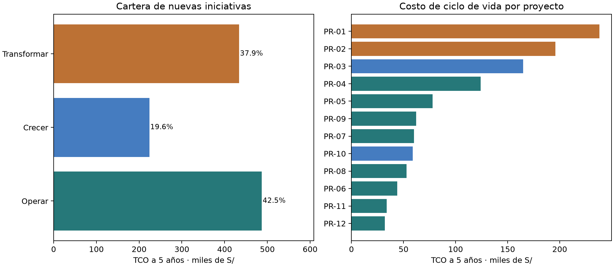
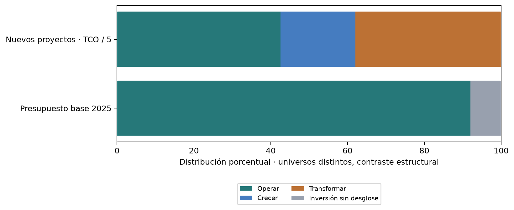
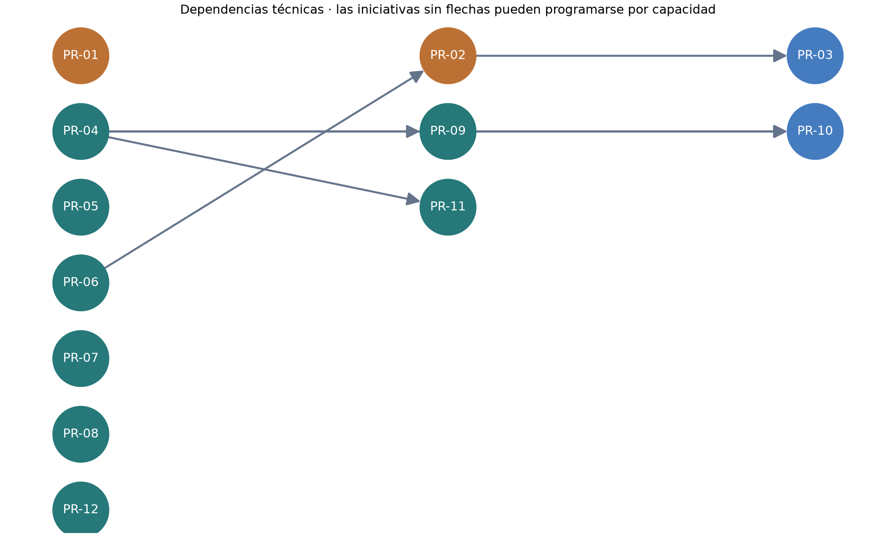

# TALLER DE LABORATORIO N.º 13

Construcción del portafolio de proyectos de TI · Ficha 3

UNIVERSIDAD PRIVADA DE TACNA

FACULTAD DE INGENIERÍA

ESCUELA DE INGENIERÍA DE SISTEMAS

CADENA DE FARMACIAS BUENA SALUD E.I.R.L.

CURSO: PLANEAMIENTO ESTRATÉGICO DE TI · SI-886

EQUIPO: Llanos-Llica

ESTUDIANTE: Vincenzo Rafael Llanos Niño

CÓDIGO: 2023076796

DOCENTE: Dr. Oscar Juan Jimenez Flores

TACNA — PERÚ · 2026

Caso ficticio del banco docente · Empresa 10 · Equipo Llanos-Llica. Identificación consignada: Vincenzo Rafael Llanos Niño, 2023076796. El número de grupo se completará según asignación del curso.

# Índice

Estructura EPIS de la plantilla Word oficial; anexos completos incluidos.

| Contenido | Página |
| --- | --- |
| 1. Información sobre el evento práctico | 3 |
| 2. Procedimiento o metodología | 4 |
| 3. Resultados y evidencias | 5 |
| 4. Conclusiones | 6 |
| 5. Cuestionario | 7 |
| 6. Referencias bibliográficas | 8 |
| 7. Anexos | 9 |
| Anexo A · Base analítica y control de admisión | 10 |
| Anexo A · Objetivos y cartera | 11 |
| Anexo B · Costo total de propiedad | 12 |
| Anexo B · Registro de supuestos | 13 |
| Anexo C · PR-01 · Caso de negocio | 14 |
| Anexo C · PR-02 · Caso de negocio | 15 |
| Anexo C · PR-03 · Caso de negocio | 16 |
| Anexo D · Presupuesto y decisiones históricas | 17 |
| Anexo D · Balance y costo por proyecto | 18 |
| Anexo E · Dependencias de implementación | 19 |
| Anexo F · Impacto sostenible | 20 |
| Anexo G · Ficha PR-01 | 26 |
| Anexo H · Validación y cierre | 38 |

Los anexos F y G contienen, respectivamente, seis páginas de evaluación sostenible y doce fichas. Las páginas del índice corresponden al PDF de esta entrega; el Word editable puede repaginar según la aplicación.

# 1. Información sobre el evento práctico

### 1.1 Título

Construcción de una cartera trazable para Farmacias Buena Salud: control farmacéutico, consolidación de stock, reposición y gobierno del valor.

### 1.2 Objetivos del trabajo

Proponer doce inversiones justificadas por evidencia del caso; comparar compromisos de costo y alternativas bajo supuestos explícitos; establecer responsables, umbrales y dependencias para una decisión gerencial revisable.

### 1.3 Tiempo de duración

Sesión de laboratorio más elaboración documental y comprobación posterior. No se declara una duración real de ejecución del estudiante que no haya sido registrada. Los plazos de las fichas son estimaciones de proyectos, no del taller.

### 1.4 Resultados de aprendizaje evidenciados

Transformar diagnóstico en una cartera justificable; distinguir datos observados de estimaciones; interpretar costos de ciclo de vida y sustentar una recomendación que considere cumplimiento, capacidad y riesgo.

### 1.5 Recursos

| Recurso | Uso |
| --- | --- |
| Banco Empresa 10, semanas 7–13 | Diagnóstico, estrategia, contratos, inversión y presupuesto; copias y procedencia en fuentes/. |
| Python 3.15 + pandas 3.1.1 | Admisión, costos, alternativas y validación reproducibles. |
| networkx 3.7 + matplotlib 3.11.2 | DAG, orden topológico y gráficos. |
| openpyxl 3.1.5 | Libro Excel con fórmulas visibles. |
| python-docx 1.2.0 + ReportLab 5.1.0 | Word editable basado en plantilla y PDF desde el mismo contenido. |

### 1.6 Seguridad y alcance

Se usan exclusivamente archivos del caso ficticio. No se solicitan cotizaciones en nombre de la empresa ni se incluyen datos reales de pacientes. El modelo no aconseja tratamientos ni sustituye registros farmacéuticos exigibles. Las estimaciones no equivalen a presupuestos aprobados; la aplicabilidad normativa se revisa con asesoría y dirección técnica.

# 2. Procedimiento o metodología

### Paso A · Admisión y depuración

Leer fuentes, derivar la base analítica y ejecutar python 07_portafolio/PF01_consolidacion.py. Se admiten doce candidatos de cinco fuentes; C-13 se fusiona y C-14 se retira. Evidencia: PF00 y PF01; anexo A.

### Paso B · Fichas y costo de propiedad

Ejecutar python 07_portafolio/PF02_tco.py y python 07_portafolio/modelo_s13.py. Se desglosa inversión y operación, se añade salida y se calcula rango por proyecto. Evidencia: PF02 y doce fichas; anexos B y G.

### Paso C · Alternativas y sostenibilidad

Ejecutar python 07_portafolio/PF04_alternativas.py. PR-01, PR-02 y PR-03 son los tres mayores tanto por inversión como por TCO. Se usa el mismo horizonte de cinco años para costos e inacción; anexo C.

### Paso D · Balance y dependencias

Ejecutar python 07_portafolio/PF05_balance.py y python 07_portafolio/PF06_dependencias.py. Separar presupuesto histórico, cartera nueva y equivalente anual; validar DAG y habilitadores. Evidencia: anexos D y E.

### Paso E · Sección 7.1

Redactar 7.1.1–7.1.8 con referencias a fuentes, doce fichas, casos, balance, dependencias y cobertura de OD-01..06. El archivo completo se entrega en 07_portafolio/7.1_Portafolio_de_Proyectos.md.

### Paso F · Validar y corregir

Ejecutar python 07_portafolio/modelo_s13.py desde cualquier directorio. Se comprueban objetivos, conservación del alcance fusionado y TCO con operación, además de rangos, fichas y ausencia de ciclos. Salidas guardadas en evidencias/S13/salidas/.

### Paso G · Registrar evidencia

Versionar artefactos en SI886-S13-TALLER-Llanos-Llica. El registro enlaza cada resultado y PUBLICACION.md documenta el estado de subida, PR a develop y etiquetas taller-13 / v0.13; no se afirma un PR que no exista.

Reproducción: crear entorno virtual, instalar requirements.txt y ejecutar python 07_portafolio/modelo_s13.py. Los programas calculan desde datos_proyectos.json; no dependen de rutas absolutas ni del repositorio del docente.

# 3. Resultados y evidencias

Equipo Llanos-Llica · Evidencia incorporada y enlaces por resultado.

| N.º | Resultado | Estado técnico | Prueba incorporada / enlace |
| --- | --- | --- | --- |
| 1 | Cinco fuentes | Verificado en base analítica | [E01](https://github.com/Vinny-13/SI886-S13-TALLER-Llanos-Llica/blob/taller-13/07_portafolio/PF01_portafolio_candidatos.csv) Anexo A; PF01_portafolio_candidatos.csv |
| 2 | Control de admisión | 12 admitidos; 1 fusionado; 1 retirado | [E02](https://github.com/Vinny-13/SI886-S13-TALLER-Llanos-Llica/blob/taller-13/evidencias/S13/salidas/PF01_control_admision.txt) Anexo A; PF00_admision.csv |
| 3 | ≥12 con origen | 12; citas a fuente y sección elaborada | [E03](https://github.com/Vinny-13/SI886-S13-TALLER-Llanos-Llica/blob/taller-13/07_portafolio/PF01_portafolio_candidatos.csv) Anexo A; no se afirma PETI previo aprobado |
| 4 | Fichas de 20 campos | 12 completas | [E04](https://github.com/Vinny-13/SI886-S13-TALLER-Llanos-Llica/tree/taller-13/07_portafolio/PF03_fichas) Anexo G; PF03_fichas/ |
| 5 | TCO5 y rango | 12 completos con costo de salida | [E05](https://github.com/Vinny-13/SI886-S13-TALLER-Llanos-Llica/blob/taller-13/07_portafolio/PF02_tco.csv) Anexo B; PF02_tco.csv |
| 6 | Factor interpretado | 2,0017× agregado | [E06](https://github.com/Vinny-13/SI886-S13-TALLER-Llanos-Llica/blob/taller-13/evidencias/S13/salidas/PF02_resultados.txt) Anexo B; PF02_resultados.txt |
| 7 | Tres casos / tres alternativas | 9 escenarios comparables | [E07](https://github.com/Vinny-13/SI886-S13-TALLER-Llanos-Llica/blob/taller-13/07_portafolio/PF04_alternativas.csv) Anexo C; PF04_alternativas.csv |
| 8 | Inacción cuantificada | 3 modelos; supuestos identificados | [E08](https://github.com/Vinny-13/SI886-S13-TALLER-Llanos-Llica/blob/taller-13/07_portafolio/supuestos.csv) Anexo C; supuestos.csv |
| 9 | Balance vs actual | Contraste estructural con límites | [E09](https://github.com/Vinny-13/SI886-S13-TALLER-Llanos-Llica/blob/taller-13/evidencias/S13/salidas/PF05_balance_resultados.txt) Anexo D; PF05_balance.csv |
| 10 | Gráficos balance y TCO | Incluidos y exportados | [E10](https://github.com/Vinny-13/SI886-S13-TALLER-Llanos-Llica/blob/taller-13/07_portafolio/graficos/PF_balance.png) Anexo D; graficos/ |
| 11 | DAG y orden | Sin ciclos; cuatro habilitadores | [E11](https://github.com/Vinny-13/SI886-S13-TALLER-Llanos-Llica/blob/taller-13/evidencias/S13/salidas/PF06_dependencias_resultados.txt) Anexo E; PF06_dependencias_resultados.txt |
| 12 | Objetivos cubiertos | 6/6 en base analítica propuesta | [E12](https://github.com/Vinny-13/SI886-S13-TALLER-Llanos-Llica/blob/taller-13/07_portafolio/PF07_cobertura.csv) Anexos A y H; PF07_cobertura.csv |
| 13 | Sección 7.1 / v0.13 | Documento completo; ver estado de etiqueta | [E13](https://github.com/Vinny-13/SI886-S13-TALLER-Llanos-Llica/blob/taller-13/07_portafolio/7.1_Portafolio_de_Proyectos.md) 7.1_Portafolio_de_Proyectos.md; anexo H |

Cada identificador E01–E13 enlaza al artefacto correspondiente en el repositorio Llanos-Llica, etiqueta taller-13. Los anexos permiten revisar el mismo contenido sin conexión. El estado de disponibilidad remota se registra en PUBLICACION.md; preparar un enlace no equivale a verificar su publicación.

### Problemas y mejoras

1) No se recibió el PETI previo: se aporta una base analítica trazable, que debe armonizarse con las secciones del equipo. 2) No hay cotizaciones: rangos ±25%/±30% y supuestos verificables. 3) Repositorio identificado: SI886-S13-TALLER-Llanos-Llica; el estado de publicación se registra en PUBLICACION.md. Falta número de grupo. 4) El archivo de pagos no etiqueta gasto TI: se analiza su alcance sin atribuirle costos indebidamente.

# 4. Conclusiones

1. El compromiso quinquenal propuesto es S/ 1 145 000 frente a S/ 572 000 de inversión inicial: 2,0017 veces. La operación aporta S/ 535 000 y la salida S/ 38 000. Una decisión basada solo en compra inicial omitiría S/ 573 000 del ciclo de vida (anexo B).

2. La cartera prioriza problemas concretos: 214 unidades de diferencia, dos fallos semanales de consolidación y tres sistemas sin respaldo. Esos hechos justifican investigar y actuar; no demuestran por sí solos el monto de una pérdida futura. Los modelos monetarios dependen de S-01..S-06 (anexos A y C).

3. El histórico ejecutó S/ 402 214,61 frente a S/ 468 000 planificados, una subejecución de 14,06%. Las tres inversiones cerradas son otro universo y periodo: no se suman a ese presupuesto ni sus sobrecostos se usan para explicar automáticamente la subejecución (anexo D).

4. PR-06 habilita PR-02 y este a PR-03. Financiar reposición sin estabilizar stock traslada errores al cálculo de compras. PR-04 habilita acceso y atención de derechos. La secuencia debe preceder al calendario y ajustarse a tres personas de TI (anexo E).

5. La participación de Transformar es 37,90% del TCO de nuevas iniciativas: supera la referencia de aula de 10–20%. Requiere pilotos y puertas de inversión; no significa que 37,90% de todo el presupuesto TI se destinará a transformación (anexo D).

### Decisión propuesta

Autorizar primero controles de trazabilidad y privacidad, recuperación y transferencia de conocimiento; abrir pilotos de consolidación y trazabilidad con aceptación formal. Condicionar ampliaciones a pruebas y a validación económica. La cartera es candidata: no se presenta como inversión aprobada.

# 5. Cuestionario

Respuestas de transferencia y cierre; la guía no contiene un cuestionario numerado.

### ¿Qué riesgo correría una organización real si esto se hiciera mal?

Podría mantener diferencias de medicamentos sin investigación, tratar datos de salud sin control y comprar sobre stock desactualizado. Además, asumiría contratos y costos recurrentes sin aprobación explícita y sin saber si los beneficios ocurrieron.

### ¿Qué información convierte una lista de proyectos en una decisión de inversión?

Un problema trazable, alternativas comparables, costo total, consecuencias de no actuar, métricas y responsable de verificar el resultado. En esta cartera cada proyecto incluye los veinte campos y los tres mayores tienen comparación económica y de riesgos.

### ¿Cuál sobreviviría si solo se aprobara uno?

PR-01 por la brecha de trazabilidad de productos controlados y el riesgo de perder evidencia. Empezaría con el piloto y control conciliatorio de la alternativa B; la ampliación a C requeriría demostrar cobertura y validación del director técnico. Esta elección no elimina la urgencia independiente de privacidad y recuperación.

### ¿Por qué no se elige siempre la alternativa más barata?

El TCO incremental de no actuar es cero en el modelo, pero conserva exposición económica y riesgos. En PR-01, B tiene mejor neto modelado que C; C solo se justifica por la cobertura de 23 locales y el control verificable, con ampliación condicionada.

### ¿Las horas liberadas equivalen a ahorro?

No. Son capacidad disponible para reasignar; solo serían ahorro de caja si una decisión verificable redujera horas extra o contratación. Por eso se separa capacidad del componente monetario evitable en los casos de negocio.

# 6. Referencias bibliográficas

Jimenez Flores, O. J. (s. f.). Semana 13: Construcción del portafolio de proyectos [Guía del curso]. Universidad Privada de Tacna. https://github.com/OscarJimenezFlores/PETI/blob/main/SEMANA-13/3-TALLER.md

Jimenez Flores, O. J. (s. f.). SI886-PLANTILLA-TALLER [Plantilla Word]. Universidad Privada de Tacna. https://github.com/OscarJimenezFlores/PETI/blob/main/PLANTILLAS/SI886-PLANTILLA-TALLER.docx

Jimenez Flores, O. J. (s. f.). Empresa 10: Expedientes, presupuesto, pagos e inversiones cerradas [Caso ficticio, semana 13]. https://github.com/OscarJimenezFlores/PETI/tree/main/SEMANA-13/RECURSOS-TALLER/EMPRESA-10-farmacias-buena-salud

Jimenez Flores, O. J. (s. f.). Empresa 10: Arquitectura actual y ficha [Caso ficticio, semana 10]. https://github.com/OscarJimenezFlores/PETI/tree/main/SEMANA-10/RECURSOS-TALLER/EMPRESA-10-farmacias-buena-salud

Jimenez Flores, O. J. (s. f.). Empresa 10: Mesa de servicio y SLA [Caso ficticio, semana 11]. https://github.com/OscarJimenezFlores/PETI/blob/main/SEMANA-11/RECURSOS-TALLER/EMPRESA-10-farmacias-buena-salud/mesa-de-servicio-y-sla.md

Jimenez Flores, O. J. (s. f.). Empresa 10: Plan institucional y registro de datos y licencias [Casos, semanas 7 y 8]. https://github.com/OscarJimenezFlores/PETI/tree/main/SEMANA-08/RECURSOS-TALLER/EMPRESA-10-farmacias-buena-salud

Congreso de la República del Perú. (2011). Ley N.º 29733, Ley de Protección de Datos Personales. https://www.gob.pe/institucion/congreso-de-la-republica/normas-legales/243470-29733

Poder Ejecutivo del Perú. (2024). Decreto Supremo N.º 016-2024-JUS, Reglamento de la Ley N.º 29733. https://busquedas.elperuano.pe/dispositivo/SE/2349653-1

Consulta del banco: 5 de noviembre de 2026. Copia de trabajo del curso: commit 5a1cb79deb1dc1cb6508082f7b786f682bdd3d35. fuentes/procedencia.json identifica la URL específica de cada archivo. Se evita trasladar el marco de gobierno digital obligatorio del sector público a esta empresa privada.

# 7. Anexos

Las evidencias se incluyen completas; no se remite a anexos inexistentes.

| Anexo | Contenido y archivo acompañante |
| --- | --- |
| A | Base analítica de secciones 3.5, 4.1.5, 4.3.5, 5.4.2, 6.1.7 y 6.2; admisión y cartera. base_academica/ y PF00/PF01. |
| B | TCO por proyecto, desglose, rangos, supuestos y fórmulas. PF02_tco.csv y Anexo_A_Portafolio_y_TCO.xlsx. |
| C | Tres casos completos, nueve alternativas y sensibilidad. PF04_alternativas.csv. |
| D | Balance, presupuesto, inversiones históricas y alcance de pagos. PF05 y PF08. |
| E | Dependencias, orden topológico y programación por capacidad. PF06. |
| F | Impacto sostenible en cinco dimensiones para los doce proyectos. PF09_sostenibilidad.csv. |
| G | Doce fichas estandarizadas, veinte campos por proyecto. PF03_fichas/PR-01.md a PR-12.md. |
| H | Comprobaciones, cobertura de objetivos, procedencia y cierre de publicación. PF07, PUBLICACION.md y MANIFIESTO_SHA256.csv. |

La base analítica del anexo A se elabora para este informe con evidencia del banco. Los códigos de origen y objetivos son aportes de análisis, no una atribución a documentos previos del estudiante. La coherencia interna está comprobada; su incorporación al PETI del equipo requiere revisión.

Estructura: se conserva el orden de siete secciones de la plantilla Word oficial. La mención de «sección 5. Resultados» en el texto de la guía no coincide con esa plantilla; se sigue su estructura real, donde Resultados es la sección 3.

# Anexo A · Base analítica y control de admisión

7.1.1 Fuentes admisibles · Secciones previas elaboradas para esta entrega

| Origen | Brecha / estrategia | Sustento y decisión | Proyecto |
| --- | --- | --- | --- |
| 4.1.5 N-01 | Trazabilidad sectorial | 214 unidades discrepantes y retención de detalle de 90 días. El caso menciona exigencias de DIGEMID; su plazo exacto y admisión de libros electrónicos requieren validación sectorial. | PR-01 |
| 4.1.5 N-02 | Protección de datos | Seis tratamientos con vacíos; historial de medicamentos en marketing. Ley 29733 y reglamento como marco general; no se inventan multas ni plazos específicos. | PR-04 |
| 4.1.5 N-03 | Derechos de uso de software | Inventario con diferencias y etiquetas contradictorias. Verificar licencias y edición antes de imputar infracción o comprar. | PR-08 |
| 5.4.2 PT-01 | Integración confiable | Consolidación nocturna por archivos, dos fallos por semana y falta de soporte alterno. | PR-02 |
| 5.4.2 PT-02 | Control de identidades | Solo correo usa segundo factor y el POS no exige la política de contraseñas. | PR-09 |
| 4.3.5 BC-01 | Recuperación comprobada | Tres sistemas fuera de respaldos; no hay continuidad aprobada. Brecha de capacidad propuesta, sin asignar un nivel COBIT no medido. | PR-05 |
| 4.3.5 BC-02 | Medición de valor | Dos inversiones sin medición y una parcial; comité no activo. | PR-12 |
| 3.5 E-01 | DA: corregir compras con stock validado | Debilidad: compras por hojas y correo. Amenaza: exceso de compra y stock inconsistente. Respuesta: planificación sobre dato validado. | PR-03 |
| 3.5 E-02 | DA: reducir dependencia del experto | Debilidad: solo una persona reprocesa. Amenaza: indisponibilidad de esa persona. Respuesta: transferencia documentada. | PR-06 |
| 3.5 E-03 | DO: formación por rol | Debilidad: inducción desactualizada. Oportunidad: meta institucional de 24 h de capacitación. | PR-11 |
| 6.1.7 SD-01 | Servicio interno de soporte | Sin catálogo aprobado; 169 pendientes y registros incompletos. | PR-07 |
| 6.1.7 SD-02 | Servicio de derechos del cliente | No hay procedimiento para atender acceso o supresión de datos. Se propone un canal seguro sin ampliar uso de datos sensibles. | PR-10 |

Admisión: C-01..C-12 corresponden a PR-01..PR-12. C-13 «consulta de estado» se fusiona en PR-10 y conserva notificaciones y seguimiento. C-14 «asistente de recomendación de medicamentos» se retira por no tener fuente ni objetivo admisible. No queda costo duplicado por la fusión.

# Anexo A · Objetivos y cartera

7.1.2 Portafolio · 7.1.8 Cobertura de objetivos de la sección 6.2 propuesta

| Objetivo propuesto | Línea base / meta verificable | Vínculo institucional |
| --- | --- | --- |
| OD-01 · Trazabilidad verificable de productos controlados | 214 unidades discrepantes en cuatro locales; no es una tasa de error. Meta: 100% movimientos conciliados; ninguna diferencia sin investigación. | OE-02 / prioridad sectorial |
| OD-02 · Consolidación confiable y conocimiento compartido | Dos fallos semanales y un único operador experto. Meta: 99% cierres antes de 07:00 y dos operadores habilitados. | OE-02 y OE-04 |
| OD-03 · Reposición eficiente con aprobación humana | Compras en hojas y correo; tiempo y pérdidas no medidos. Meta: Reducir 20% tiempo frente a línea base de cuatro semanas. | OE-02 y OE-05 |
| OD-04 · Tratamiento de datos y uso de software controlados | Seis tratamientos registrados con vacíos y derechos de uso por verificar. Meta: 100% tratamientos y estaciones con control documentado. | OE-01 / obligación de cumplimiento |
| OD-05 · Servicios recuperables y soporte medible | Tres sistemas sin copia; 169 tickets abiertos. Meta: Cobertura total de copia y <=85 tickets pendientes. | OE-02 y OE-04 |
| OD-06 · Competencias y gobierno orientados a resultados | 12 h de capacitación institucional; beneficios no medidos plenamente. Meta: 24 h anuales y 100% inversiones con evaluación posterior. | OE-03 y OE-05 |

### Cartera depurada: códigos y trazabilidad

| Proyecto | Origen | Objetivo | Categoría |
| --- | --- | --- | --- |
| PR-01 · Trazabilidad de productos controlados | 4.1.5 N-01 | OD-01 | Transformar |
| PR-02 · Consolidación de stock tolerante a fallos | 5.4.2 PT-01 | OD-02 | Transformar |
| PR-03 · Reposición y distribución asistidas por demanda | 3.5 E-01 | OD-03 | Crecer |
| PR-04 · Protección de datos en fidelización y personal | 4.1.5 N-02 | OD-04 | Operar |
| PR-05 · Recuperación comprobada de sistemas críticos | 4.3.5 BC-01 | OD-05 | Operar |
| PR-06 · Transferencia de conocimiento del proceso nocturno | 3.5 E-02 | OD-02 | Operar |
| PR-07 · Mesa de servicio con catálogo y acuerdos medibles | 6.1.7 SD-01 | OD-05 | Operar |
| PR-08 · Inventario de software y regularización de uso | 4.1.5 N-03 | OD-04 | Operar |
| PR-09 · Ciclo de vida de accesos y cuentas privilegiadas | 5.4.2 PT-02 | OD-04 | Operar |
| PR-10 · Canal de ejercicio de derechos del cliente | 6.1.7 SD-02 | OD-04 | Crecer |
| PR-11 · Formación por rol en seguridad y dispensación digital | 3.5 E-03 | OD-06 | Operar |
| PR-12 · Control de inversiones y verificación de beneficios | 4.3.5 BC-02 | OD-06 | Operar |

Cobertura: OD-01 → PR-01; OD-02 → PR-02/06; OD-03 → PR-03; OD-04 → PR-04/08/09/10; OD-05 → PR-05/07; OD-06 → PR-11/12. Resultado: seis objetivos cubiertos. No se afirma cobertura de otros objetivos del PETI que no se hayan recibido.

# Anexo B · Costo total de propiedad

7.1.4 · Soles constantes 2026; cinco años desde aceptación

TCO5 = inversión inicial + 5 × operación anual + costo de salida. La inversión incluye implementación, migración, integración y capacitación inicial; la operación incluye licencias, alojamiento, soporte, personal dedicado y formación recurrente. Las fracciones de EA-01 son supuestos de estimación, no consumos históricos ni ofertas de proveedor.

| Código | Inicial | Anual | Salida | TCO5 | Rango bajo–alto | Factor |
| --- | --- | --- | --- | --- | --- | --- |
| PR-01 | 120 000 | 22 000 | 8 000 | 238 000 | 166 600–309 400 | 1.98× |
| PR-02 | 100 000 | 18 000 | 6 000 | 196 000 | 137 200–254 800 | 1.96× |
| PR-03 | 85 000 | 15 000 | 5 000 | 165 000 | 115 500–214 500 | 1.94× |
| PR-04 | 60 000 | 12 000 | 4 000 | 124 000 | 93 000–155 000 | 2.07× |
| PR-05 | 35 000 | 8 000 | 3 000 | 78 000 | 58 500–97 500 | 2.23× |
| PR-06 | 22 000 | 4 000 | 2 000 | 44 000 | 33 000–55 000 | 2.00× |
| PR-07 | 28 000 | 6 000 | 2 000 | 60 000 | 45 000–75 000 | 2.14× |
| PR-08 | 26 000 | 5 000 | 2 000 | 53 000 | 39 750–66 250 | 2.04× |
| PR-09 | 30 000 | 6 000 | 2 000 | 62 000 | 46 500–77 500 | 2.07× |
| PR-10 | 32 000 | 5 000 | 2 000 | 59 000 | 44 250–73 750 | 1.84× |
| PR-11 | 18 000 | 3 000 | 1 000 | 34 000 | 25 500–42 500 | 1.89× |
| PR-12 | 16 000 | 3 000 | 1 000 | 32 000 | 24 000–40 000 | 2.00× |
| TOTAL | 572 000 | 107 000 | 38 000 | 1 145 000 | 828 800–1 461 200 | 2,0017× |

Los tres mayores son PR-01 (S/ 238 000), PR-02 (S/ 196 000) y PR-03 (S/ 165 000). También son los de mayor inversión inicial y operación anual, por lo que no hay ambigüedad en la selección de casos. La carga recurrente de los tres suma S/ 55 000/año: 51,40% de la operación propuesta.

### Interpretación e incertidumbre

Por cada sol de inversión inicial se comprometen aproximadamente S/ 2,00 de ciclo de vida. Los rangos de ±30% en PR-01..03 y ±25% en los demás son sensibilidad de estimación, no intervalos de confianza. La suma de extremos es un escenario conservador de variación conjunta, no una predicción probabilística.

Ejemplo PR-01: inversión 72 000 implementación + 18 000 migración + 18 000 integración + 12 000 formación = 120 000. Operación anual: 5 500 licencias + 4 400 alojamiento + 5 500 soporte + 4 400 personal + 2 200 formación = 22 000. TCO: 120 000 + 110 000 + 8 000 = 238 000. El Excel contiene este desglose para todos los proyectos.

Se contabiliza cada componente una sola vez. Se presupone contratación externa donde corresponda; el esfuerzo interno debe conciliarse con nómina para no duplicar costos al integrar el plan. No se han incorporado multas, costos de tratamientos médicos ni ingresos sin evidencia.

# Anexo B · Registro de supuestos

La evidencia del caso fundamenta el problema; los supuestos dimensionan las soluciones.

| ID | Concepto y supuesto | Cómo validarlo |
| --- | --- | --- |
| EA-01 | Costo de proyectos: Descomposición paramétrica de diseño por esfuerzo y alcance; sin cotización. Inversión 60% implementación, 15% migración, 15% integración, 10% formación; operación 25% licencias, 20% alojamiento, 25% soporte, 20% personal, 10% formación. | Validar con al menos dos referencias comparables y dimensionamiento; no afirmar precio de mercado. |
| S-01 | PR-01: exposición de unidades: 214 unidades × S/ 200 por unidad = S/ 42 800/año. Las 214 unidades son un hecho de 2025; su repetición anual y el precio son supuestos. | Director técnico y contabilidad: valorar productos afectados y medir frecuencia durante 8 semanas. |
| S-02 | PR-01: capacidad de conciliación: 4 locales × 5 h/semana × 52 semanas × S/ 25/h = S/ 26 000/año. Total exposición económica PR-01: S/ 68 800/año. | Medir tiempos; las horas son capacidad liberable, no ahorro automático de nómina. |
| S-03 | PR-02: fallos: 2 fallos/semana × 52 = 104 eventos/año. Por evento: S/ 500 de margen no realizado supuesto y 3 h × S/ 60/h de reproceso. Total S/ 70 720/año. | Validar fallos, horas y ventas perdidas; no confundir facturación con margen. |
| S-04 | PR-03: reposición: 23 locales × 2 h/semana × 52 × S/ 25/h = S/ 59 800/año de capacidad; pérdidas por exceso/vencimiento S/ 120 000/año supuestas. Total S/ 179 800/año. | Medir cuatro semanas y conciliar mermas con contabilidad; S/ 120 000 no procede del CSV. |
| S-05 | Eficacia de alternativas: PR-01/02: B evita 60% y C 90% de exposición. PR-03: B reduce 10% horas y 10% pérdida; C 20% horas y 25% pérdida. | Someter a piloto y sensibilidad; no son beneficios garantizados. |
| S-06 | Horizonte y precios: Cinco años de operación estable desde aceptación; soles constantes 2026; impuestos incluidos como supuesto de monto final. Sin descuento, inflación ni valor residual; salida al final del año 5. | Presupuesto de caja y VAN requieren calendario, inflación y tasa aprobados. No interpretar TCO/5 como caja anual. |
| S-07 | Metas y secciones previas: OD-01..06, N/PT/BC/E/SD y sus metas son propuestas analíticas elaboradas aquí a partir del banco de casos. No son secciones previas aprobadas del equipo. | Validar contra PETI del equipo; sin actas recibidas no afirmar aprobación. |
| S-08 | No duplicar beneficios: PR-02 mide reproceso y margen perdido por fallo; PR-03 solo preparación y merma residual atribuible a planificación, excluyendo pérdida ya atribuida a fallo. | Beneficios no se agregan a nivel de cartera hasta verificar atribución y que no exista solapamiento. |

# Anexo C · PR-01 · Caso de negocio

7.1.5 · Trazabilidad de productos controlados

La brecha es de control de movimientos: 214 unidades de diferencia en cuatro locales y pérdida de detalle tras 90 días. No se atribuye un daño clínico ni una infracción ya sancionada.

Objetivo: OD-01. Responsable del beneficio: Director técnico. Alcance y exclusiones: ficha correspondiente del anexo G.

| Alternativa | Qué cambia |
| --- | --- |
| A | Mantener libro y POS actuales; se conserva la brecha y la operación base. |
| B | Conciliación asistida y alertas en cuatro locales de riesgo; controles manuales reforzados. |
| C | Trazabilidad y conciliación en 23 locales; bitácora, controles y auditoría de movimientos. |

| Indicador (S/) | A · No actuar | B · Mínima | C · Completa |
| --- | --- | --- | --- |
| Inversión | 0 | 50 000 | 120 000 |
| Operación anual incremental | 0 | 10 000 | 22 000 |
| Salida | 0 | 4 000 | 8 000 |
| TCO5 incremental | 0 | 104 000 | 238 000 |
| TCO5 bajo (−30%) | 0 | 72 800 | 166 600 |
| TCO5 alto (+30%) | 0 | 135 200 | 309 400 |
| Exposición residual 5 años | 344 000 | 137 600 | 34 400 |
| Beneficio evitable vs A, 5 años | 0 | 206 400 | 309 600 |
| Neto económico vs A | 0 | 102 400 | 71 600 |

S-01/S-02: 214 × 200 + 4 × 5 × 52 × 25 = S/ 68 800/año; exposición quinquenal S/ 344 000. B evita 60%; C 90%.

### Recomendación y condición de aceptación

B tiene mayor neto económico modelado (S/ 102 400 frente a S/ 71 600 de C). Se recomienda B como puerta inicial y C como alcance objetivo condicionado a justificar cobertura de 23 locales y superar aceptación técnica; el control farmacéutico no se decide únicamente por retorno. No se autoriza de una vez todo el monto.

Criterio verificable: 100 % de movimientos del piloto conciliados cada día; cero diferencias sin expediente de investigación al cierre mensual.

### Sensibilidad y naturaleza del beneficio

C cubre su TCO si evita S/ 47 600/año; al 90% requiere exposición anual de S/ 52 889. Con TCO +30%, el neto económico baja a S/ 200. El componente monetario evitable de unidades es S/ 192 600 en cinco años; la capacidad valorada aporta S/ 117 000 y no equivale a ahorro de caja.

### Riesgo y decisión de adquisición

El POS puede no entregar el detalle requerido. Validar exportación, responsabilidades y compatibilidad; conservar el libro exigible y definir retención con dirección técnica antes de digitalizar. Comprar o extender módulo especializado antes que construir; comparar proveedor actual, módulo alternativo y conciliador abierto adaptado. No se adjudica proveedor sin ensayo y evaluación de exportabilidad.

A tiene beneficio de inacción negativo: -S/ 344 000. El TCO A es cero incremental porque la operación vigente permanece en el presupuesto base. No se suma la pérdida al TCO contable. Para comparar carga económica se usa TCO + pérdida residual, que se entrega en el CSV. Valores modelados, sin descuento; cinco años de operación estable.

# Anexo C · PR-02 · Caso de negocio

7.1.5 · Consolidación de stock tolerante a fallos

El proceso nocturno falla dos veces por semana y depende de una sola persona. Los 23 locales necesitan consolidación confiable antes de planificar compras.

Objetivo: OD-02. Responsable del beneficio: Jefe de Sistemas. Alcance y exclusiones: ficha correspondiente del anexo G.

| Alternativa | Qué cambia |
| --- | --- |
| A | Mantener reproceso manual y dependencia del jefe de Sistemas. |
| B | Cola de archivos con reintentos y manual; supervisión limitada. |
| C | Motor supervisado, idempotencia, conciliación y dos operadores; despliegue progresivo a 23 locales. |

| Indicador (S/) | A · No actuar | B · Mínima | C · Completa |
| --- | --- | --- | --- |
| Inversión | 0 | 60 000 | 100 000 |
| Operación anual incremental | 0 | 10 000 | 18 000 |
| Salida | 0 | 4 000 | 6 000 |
| TCO5 incremental | 0 | 114 000 | 196 000 |
| TCO5 bajo (−30%) | 0 | 79 800 | 137 200 |
| TCO5 alto (+30%) | 0 | 148 200 | 254 800 |
| Exposición residual 5 años | 353 600 | 141 440 | 35 360 |
| Beneficio evitable vs A, 5 años | 0 | 212 160 | 318 240 |
| Neto económico vs A | 0 | 98 160 | 122 240 |

S-03: 104 eventos/año × (S/ 500 de margen + 3 h × S/ 60/h) = S/ 70 720/año; cinco años S/ 353 600. B evita 60%; C 90%.

### Recomendación y condición de aceptación

C presenta el mayor neto económico modelado: S/ 122 240 frente a S/ 98 160 de B. Se recomienda C por etapas después de PR-06, con prueba en cuatro locales y ampliación al lograr 99% de cierres antes de las 07:00 durante 60 días.

Criterio verificable: Al menos 99 % de cierres consolidados antes de las 07:00 durante 60 días y dos personas capaces de reprocesar.

### Sensibilidad y naturaleza del beneficio

C requiere evitar S/ 39 200/año. Con eficacia de 90%, la exposición anual mínima es S/ 43 556. Con TCO +30%, su neto económico sería S/ 63 440. De los S/ 318 240 evitables, S/ 234 000 son margen supuesto y S/ 84 240 capacidad; sin validar margen no hay rentabilidad financiera demostrada.

### Riesgo y decisión de adquisición

Reintentar puede duplicar movimientos. Exigir llaves idempotentes, conciliación y retorno; no interrumpir venta local por falta de conexión. Comparar extensión del proveedor POS, integración comercial y adaptación de un motor abierto con soporte. Preferir interfaces soportadas y salida exportable; desarrollar solo conectores específicos.

A tiene beneficio de inacción negativo: -S/ 353 600. El TCO A es cero incremental porque la operación vigente permanece en el presupuesto base. No se suma la pérdida al TCO contable. Para comparar carga económica se usa TCO + pérdida residual, que se entrega en el CSV. Valores modelados, sin descuento; cinco años de operación estable.

# Anexo C · PR-03 · Caso de negocio

7.1.5 · Reposición y distribución asistidas por demanda

Compras y distribución dependen de hojas y correo; el caso reconoce compras de más cuando falla el stock. No existe cuantificación observada de merma ni tiempo de preparación.

Objetivo: OD-03. Responsable del beneficio: Jefe de Logística. Alcance y exclusiones: ficha correspondiente del anexo G.

| Alternativa | Qué cambia |
| --- | --- |
| A | Mantener hojas, correo y reposición manual. |
| B | Reglas de mínimos y aprobaciones; integración sencilla con stock validado. |
| C | Reposición por demanda, aprobación humana, transferencias y alertas de vencimiento cuando el dato sea completo. |

| Indicador (S/) | A · No actuar | B · Mínima | C · Completa |
| --- | --- | --- | --- |
| Inversión | 0 | 45 000 | 85 000 |
| Operación anual incremental | 0 | 8 000 | 15 000 |
| Salida | 0 | 3 000 | 5 000 |
| TCO5 incremental | 0 | 88 000 | 165 000 |
| TCO5 bajo (−30%) | 0 | 61 600 | 115 500 |
| TCO5 alto (+30%) | 0 | 114 400 | 214 500 |
| Exposición residual 5 años | 899 000 | 809 100 | 689 200 |
| Beneficio evitable vs A, 5 años | 0 | 89 900 | 209 800 |
| Neto económico vs A | 0 | 1 900 | 44 800 |

S-04: 23 × 2 h × 52 × S/ 25 + S/ 120 000 = S/ 179 800/año. B evita S/ 17 980/año; C S/ 41 960/año, separando tiempo y pérdida.

### Recomendación y condición de aceptación

C tiene neto económico modelado de S/ 44 800; B solo S/ 1 900. Se recomienda un piloto de C condicionado a PR-02 y a medir cuatro semanas de base; no aprobar expansión si el beneficio anual comprobable no supera S/ 33 000 y la completitud de datos requerida.

Criterio verificable: Reducir 20 % el tiempo de preparar pedidos respecto de una medición de cuatro semanas previa al piloto.

### Sensibilidad y naturaleza del beneficio

Con TCO +30%, C presenta neto de -S/ 4 700. El componente de merma evitada suma S/ 150 000 y la capacidad S/ 59 800; solo merma no recupera el TCO. El caso no soporta aprobación financiera incondicional; su rentabilidad depende de validar supuestos y ejecución.

### Riesgo y decisión de adquisición

Planificar con lotes incompletos genera pedidos erróneos. Medir calidad, limitar recomendaciones y mantener aprobación humana; excluir pérdidas ya computadas en PR-02. Comparar módulo del POS, herramienta comercial de reposición y solución abierta adaptada. Valorar integración y mantenimiento; no sustituir automáticamente el POS vigente.

A tiene beneficio de inacción negativo: -S/ 899 000. El TCO A es cero incremental porque la operación vigente permanece en el presupuesto base. No se suma la pérdida al TCO contable. Para comparar carga económica se usa TCO + pérdida residual, que se entrega en el CSV. Valores modelados, sin descuento; cinco años de operación estable.

# Anexo D · Presupuesto y decisiones históricas

7.1.6 · Contraste con la sección 3.1 elaborada desde el presupuesto del caso

| Partida | Plan (S/) | Ejecutado (S/) | Tipo del archivo |
| --- | --- | --- | --- |
| Licencias y suscripciones | 98,280.00 | 69,734.10 | Operación |
| Soporte y mantenimiento de sistemas | 88,920.00 | 84,024.96 | Operación |
| Infraestructura y equipamiento | 79,560.00 | 49,662.18 | Operación |
| Comunicaciones y enlaces | 51,480.00 | 42,976.93 | Operación |
| Personal de TI | 93,600.00 | 91,931.28 | Operación |
| Proyectos nuevos | 37,440.00 | 42,305.24 | Inversión |
| Seguridad de la información | 18,720.00 | 21,579.92 | Operación |
| TOTAL | 468 000,00 | 402 214,61 | -14,06% |

Plan: operación S/ 430 560 (92%); inversión S/ 37 440 (8%). Ejecutado: operación S/ 359 909,37 (89,48%); inversión S/ 42 305,24 (10,52%). «Inversión» no distingue crecer de transformar: no se le asigna una categoría arbitraria. El nombre de una partida tampoco prueba su orientación estratégica.

| Inversión cerrada | Presupuesto / ejecutado (S/) | Beneficio posterior |
| --- | --- | --- |
| Videovigilancia | 297,960.60 / 481,693.41 | No se midió |
| Actualización de licencias | 122,789.00 / 141,758.23 | No se midió |
| Enlace de datos redundante | 68,244.93 / 84,706.75 | Parcial |

Los tres expedientes no tienen caso de negocio con alternativas ni aceptación formal conservada. Dos no midieron el beneficio y uno lo midió parcialmente. Las desviaciones se calculan en su propio expediente; no se exige que sumen el presupuesto anual, porque no está demostrada la equivalencia de alcance y periodo. PR-12 introduce aceptación y revisión posterior para corregir esta debilidad.

### Pagos: alcance de la evidencia

Se revisaron los 11 014 pagos de 2025: todos PEN y estado Pagado, suma S/ 16 747 445,39. Es la población de pagos de la empresa, no gasto TI. Los conceptos genéricos no permiten atribuir automáticamente cada pago a un contrato tecnológico. El resumen reproducible se conserva en PF08; se necesita conciliación de centro de costo, proveedor y comprobantes antes de inferir operación TI.

Los contratos de la semana 9 aportan referencias de escala: planilla S/ 3 254/mes e infraestructura S/ 4 962/mes más consumo. No se imputan íntegramente a nuevos proyectos ni se presentan como precios de mercado. La ubicación de datos y las condiciones de salida deben revisarse contractualmente.

# Anexo D · Balance y costo por proyecto

Cartera nueva: operar 42,53% · crecer 19,56% · transformar 37,90%

Figura D1. Balance por categoría y TCO por proyecto. Fuente: PF01 y PF02, cálculo reproducible. TCO total: S/ 1 145 000.

Figura D2. Contraste estructural entre presupuesto base y nuevas iniciativas. El equivalente anual TCO/5 asciende a S/ 229 000: operar S/ 97 400; crecer S/ 44 800; transformar S/ 86 800. Es anualización del costo de ciclo de vida, no caja anual ni un presupuesto combinado.

Frente a la referencia de aula (50–70 / 20–30 / 10–20), la cartera nueva concentra transformación. Respuesta: pilotos, aceptación por etapas y priorización por recursos. No se suma S/ 229 000 al presupuesto histórico sin identificar costos sustituidos y solapamientos. El desembolso real exige hoja de ruta 7.3 y caja año a año.

# Anexo E · Dependencias de implementación

7.1.7 · El habilitador apunta al proyecto que lo necesita

Figura E1. Grafo dirigido sin ciclos. Los nodos sin flechas no son menos importantes: su programación depende de riesgo y capacidad, además de la relación técnica.

| Relación | Motivo |
| --- | --- |
| PR-06 → PR-02 | El proceso actual debe documentarse y transferirse antes de migrarlo. |
| PR-02 → PR-03 | La reposición usa stock reconciliado; no debe automatizar datos desactualizados. |
| PR-04 → PR-09 / PR-11 | Finalidades y responsabilidades guían perfiles y capacitación. |
| PR-04 + PR-09 → PR-10 | Atender derechos requiere proceso aprobado y control de acceso. |

Orden topológico válido: PR-01, PR-04, PR-05, PR-06, PR-02, PR-03, PR-07, PR-08, PR-09, PR-10, PR-11, PR-12. Es una posibilidad matemática; no prescribe ejecutar PR-12 al final. La puerta de gobierno de PR-12 se activa antes de comprometer inversión.

Secuencia sugerida para 7.3: primero control de gobierno, privacidad, recuperación, transferencia y piloto de trazabilidad; luego consolidación y perfiles; finalmente reposición, canal de derechos y ampliaciones. La mesa de servicio y regularización de software se calendarizan según capacidad y riesgo. No se ejecutan doce iniciativas simultáneamente con tres personas de TI.

# Anexo F · Impacto sostenible

Cinco dimensiones por proyecto; metas propuestas sujetas a medición.

### PR-01 · Trazabilidad de productos controlados

| Dimensión / afectados | Indicador o efecto esperado | Norma, derecho o alcance |
| --- | --- | --- |
| Sociedad · Clientes y director técnico | 100% movimientos del piloto conciliados cada día; diferencias con investigación. | Protección del usuario; obligaciones sectoriales se validan con dirección técnica. |
| Economía · Logística y gerencia | Exposición evitable modelada C S/ 61 920/año; validar S-01/S-02. | Aprobación y aceptación internas. |
| Salud y seguridad · Dispensación y pacientes | 100% alertas de diferencia revisadas antes del cierre; no se promete reducción clínica sin estudio. | Control farmacéutico del caso; no sustituir libro exigible. |
| Marco legal · Dirección técnica | 23 locales con evidencia conciliable y retención aprobada; no se inventa plazo legal. | Validación sectorial previa a producción. |
| Medio ambiente · Almacenes | Registrar unidades descartadas por vencimiento por mes; meta inicial: cobertura de registro 100%. | No se afirma reducción de residuos sin línea base. |

### PR-02 · Consolidación de stock tolerante a fallos

| Dimensión / afectados | Indicador o efecto esperado | Norma, derecho o alcance |
| --- | --- | --- |
| Sociedad · Personal de 23 locales | 99% cierres consolidados antes de 07:00 en 60 días. | Continuidad del servicio al cliente. |
| Economía · TI y compras | S/ 63 648/año de exposición evitable modelada; margen y capacidad separados. | Control de inversión y beneficios. |
| Salud y seguridad · Dispensadores | Stock actualizado en 99% de cierres; no reemplaza verificación física de dispensación. | Seguridad del proceso; sin decisión clínica automática. |
| Marco legal · Contabilidad y dirección técnica | 100% procesos con bitácora e integridad verificada; revisión de acceso. | Protección de datos cuando el archivo incluya datos personales. |
| Medio ambiente · TI | Medir kWh del proceso por 1 000 cierres; línea base durante piloto, sin ahorro prometido. | No se requiere comprar 23 servidores nuevos en este alcance. |

No se dejan dimensiones vacías. Cuando no hay impacto material directo o no existe línea base, se explica y se define una medición proporcional. Los indicadores son compromisos propuestos, no resultados observados de una implementación.

# Anexo F · Impacto sostenible

Cinco dimensiones por proyecto; metas propuestas sujetas a medición.

### PR-03 · Reposición y distribución asistidas por demanda

| Dimensión / afectados | Indicador o efecto esperado | Norma, derecho o alcance |
| --- | --- | --- |
| Sociedad · Locales y clientes | Reducir 20% tiempo de preparación vs cuatro semanas de base. | Acceso oportuno al servicio; sin promesa clínica. |
| Economía · Compras | S/ 41 960/año evitable modelado; validar merma y tiempo. | Autorización humana de cada pedido. |
| Salud y seguridad · Farmacéuticos | 100% alertas de vencimiento revisadas cuando los datos estén completos. | No automatizar dispensación ni uso de medicamentos. |
| Marco legal · Compras y dirección técnica | 100% órdenes con responsable y bitácora de aprobación. | Validar exigencias sectoriales; minimizar datos de clientes. |
| Medio ambiente · Almacén | Meta de piloto: reducir 25% pérdida por exceso/vencimiento si la línea base confirma el supuesto. | Registrar unidades y costo de descarte; no equivaler dinero a toneladas. |

### PR-04 · Protección de datos en fidelización y personal

| Dimensión / afectados | Indicador o efecto esperado | Norma, derecho o alcance |
| --- | --- | --- |
| Sociedad · 61 000 clientes y personal | Seis actividades de tratamiento con responsable y finalidad evaluada. | Ley 29733 y reglamento. |
| Economía · Administración | 100% contratos de tratamiento del alcance revisados; riesgo no monetizado. | No se usa una multa supuesta como ingreso. |
| Salud y seguridad · Titulares | Cero exportaciones no autorizadas de historial de medicamentos a marketing. | Tratamiento reforzado de datos sensibles. |
| Marco legal · Administración | 100% actividades con base y plazo evaluados por asesoría. | Ley 29733; D. S. 016-2024-JUS, aplicabilidad concreta por revisar. |
| Medio ambiente · TI | Inventariar 100% copias de datos y retirar las autorizadas según retención; GB antes/después. | No borrar registros necesarios para conservación legítima. |

No se dejan dimensiones vacías. Cuando no hay impacto material directo o no existe línea base, se explica y se define una medición proporcional. Los indicadores son compromisos propuestos, no resultados observados de una implementación.

# Anexo F · Impacto sostenible

Cinco dimensiones por proyecto; metas propuestas sujetas a medición.

### PR-05 · Recuperación comprobada de sistemas críticos

| Dimensión / afectados | Indicador o efecto esperado | Norma, derecho o alcance |
| --- | --- | --- |
| Sociedad · Trabajadores y clientes | 100% sistemas inventariados cubiertos por copia verificada. | Continuidad operativa. |
| Economía · Gerencia | Tres restauraciones de sistemas omitidos aprobadas; pérdida evitada no monetizada. | Aceptación con actas. |
| Salud y seguridad · Dispensadores | Tres pruebas sin afectar la venta en producción. | Usar ambientes aislados y datos de prueba. |
| Marco legal · Responsables de datos | 100% copias del alcance con acceso y retención definidos. | Protección de datos; revisión de acuerdos de nube. |
| Medio ambiente · TI | Medir GB protegidos/GB almacenados y política de retención; no comprar capacidad sin dimensionar. | Consumo energético no medido todavía. |

### PR-06 · Transferencia de conocimiento del proceso nocturno

| Dimensión / afectados | Indicador o efecto esperado | Norma, derecho o alcance |
| --- | --- | --- |
| Sociedad · Tres integrantes de TI | Dos operadores alternos ejecutan tres reprocesos. | Reducción de dependencia laboral. |
| Economía · TI | Registrar horas por reproceso antes/después; no sumar beneficio ya atribuido a PR-02. | Evitar doble conteo de valor. |
| Salud y seguridad · TI | Cero credenciales reales en manuales; prácticas con datos de prueba. | Seguridad del acceso. |
| Marco legal · TI | 100% manuales con permiso por rol y versión controlada. | Confidencialidad y protección de datos. |
| Medio ambiente · TI | Manual digital versionado; impresiones registradas si se usan. | Impacto material no establecido; sin reducción porcentual inventada. |

No se dejan dimensiones vacías. Cuando no hay impacto material directo o no existe línea base, se explica y se define una medición proporcional. Los indicadores son compromisos propuestos, no resultados observados de una implementación.

# Anexo F · Impacto sostenible

Cinco dimensiones por proyecto; metas propuestas sujetas a medición.

### PR-07 · Mesa de servicio con catálogo y acuerdos medibles

| Dimensión / afectados | Indicador o efecto esperado | Norma, derecho o alcance |
| --- | --- | --- |
| Sociedad · 196 trabajadores | 95% solicitudes con tipo y prioridad; pendientes <=85. | Atención equitativa por criticidad. |
| Economía · Soporte | Medir costo por ticket y tiempo de resolución; no inferir demanda total de la hoja parcial. | Gestión interna del servicio. |
| Salud y seguridad · Locales | 100% incidencias que afecten dispensación con escalamiento al responsable. | No resolver consultas clínicas desde TI. |
| Marco legal · Soporte | 100% tickets sin datos de salud innecesarios. | Ley 29733 cuando haya datos personales. |
| Medio ambiente · TI | Registrar visitas evitadas y km antes/después; meta de medición 100% casos remotos. | No afirmar emisiones evitadas sin factor verificable. |

### PR-08 · Inventario de software y regularización de uso

| Dimensión / afectados | Indicador o efecto esperado | Norma, derecho o alcance |
| --- | --- | --- |
| Sociedad · Usuarios de 163 estaciones | 100% estaciones inventariadas sin retirar herramientas críticas sin alternativa. | Continuidad del trabajo. |
| Economía · Administración | 100% compras de licencias precedidas de verificación de edición y derecho. | Evitar comprar por diferencias falsas. |
| Salud y seguridad · Usuarios de POS | Cero desinstalaciones críticas sin plan de retorno probado. | No interferir en dispensación. |
| Marco legal · TI | 100% derechos de uso documentados o plan de regularización. | Verificar licencia aplicable; Libre/MIT no se interpreta como deuda automática. |
| Medio ambiente · TI | 100% equipos evaluados para reutilización antes de renovar. | No contempla desecho masivo de hardware. |

No se dejan dimensiones vacías. Cuando no hay impacto material directo o no existe línea base, se explica y se define una medición proporcional. Los indicadores son compromisos propuestos, no resultados observados de una implementación.

# Anexo F · Impacto sostenible

Cinco dimensiones por proyecto; metas propuestas sujetas a medición.

### PR-09 · Ciclo de vida de accesos y cuentas privilegiadas

| Dimensión / afectados | Indicador o efecto esperado | Norma, derecho o alcance |
| --- | --- | --- |
| Sociedad · Personal autorizado | 100% bajas notificadas resueltas en 24 h. | Acceso proporcional al rol. |
| Economía · Administración | Recertificación trimestral del 100% cuentas privilegiadas; pérdidas no monetizadas. | No se inventa costo de incidente. |
| Salud y seguridad · Dispensadores | 100% pruebas de acceso con plan de contingencia para mantener operación. | Validar compatibilidad del POS. |
| Marco legal · Titulares | 100% perfiles vinculados a finalidad y responsable. | Ley 29733 como marco de control de acceso. |
| Medio ambiente · TI | Sin efecto material directo identificado; no compra hardware en este alcance. | No aplica meta de residuos; se documenta el motivo. |

### PR-10 · Canal de ejercicio de derechos del cliente

| Dimensión / afectados | Indicador o efecto esperado | Norma, derecho o alcance |
| --- | --- | --- |
| Sociedad · Clientes | 100% solicitudes con acuse y responsable; formulario probado con usuarios. | Ejercicio de derechos de datos. |
| Economía · Atención | Medir minutos por solicitud y solicitudes resueltas; sin beneficio monetario supuesto. | Gestión del servicio. |
| Salud y seguridad · Titulares | Cero adjuntos de salud expuestos en notificaciones. | Minimización de datos sensibles. |
| Marco legal · Administración | 95% pedidos dentro del plazo que valide asesoría. | Ley 29733 y reglamento; no se fija un plazo legal sin verificar caso. |
| Medio ambiente · Atención | Registrar trámites sin papel y traslados declarados evitados; meta de medición 100%. | No convertir registros a CO2 sin metodología. |

No se dejan dimensiones vacías. Cuando no hay impacto material directo o no existe línea base, se explica y se define una medición proporcional. Los indicadores son compromisos propuestos, no resultados observados de una implementación.

# Anexo F · Impacto sostenible

Cinco dimensiones por proyecto; metas propuestas sujetas a medición.

### PR-11 · Formación por rol en seguridad y dispensación digital

| Dimensión / afectados | Indicador o efecto esperado | Norma, derecho o alcance |
| --- | --- | --- |
| Sociedad · 196 trabajadores | 90% del personal completa 24 h/año y alcanza 80/100. | OE-03 del plan institucional. |
| Economía · RR. HH. | Costo por participante aprobado y horas registradas; no duplica capacitación de PR-01/02. | Formación general separada de inducción específica de soluciones. |
| Salud y seguridad · Personal y clientes | 100% cohortes practican reporte seguro de incidente; sin consejo farmacológico. | Competencia de seguridad, no licencia profesional. |
| Marco legal · Trabajadores | 100% asistentes recibe formación sobre uso apropiado de datos por rol. | Ley 29733 como contenido de capacitación. |
| Medio ambiente · RR. HH. | Material digital y registro de sesiones remotas; medir impresiones por cohorte. | No se afirma ahorro sin base. |

### PR-12 · Control de inversiones y verificación de beneficios

| Dimensión / afectados | Indicador o efecto esperado | Norma, derecho o alcance |
| --- | --- | --- |
| Sociedad · Áreas usuarias | 100% inversiones con acta de aceptación y dueño del beneficio. | Rendición de cuentas interna. |
| Economía · Gerencia | 100% inversiones revisadas a 90 y 180 días con costo y resultado. | Separar presupuesto, ejecución y beneficio. |
| Salud y seguridad · Dirección técnica | 100% proyectos de dispensación incluyen validación del responsable farmacéutico. | Puerta de aprobación por criticidad. |
| Marco legal · Gerencia | 100% decisiones con responsable y revisión de cumplimiento aplicable. | Sin afirmar certificación COBIT por crear un comité. |
| Medio ambiente · Compras | 100% nuevas compras incluyen criterio de vida útil y salida de equipos cuando aplique. | No aplicar criterio de residuos a un servicio sin equipos sin justificarlo. |

No se dejan dimensiones vacías. Cuando no hay impacto material directo o no existe línea base, se explica y se define una medición proporcional. Los indicadores son compromisos propuestos, no resultados observados de una implementación.

# Anexo G · Ficha PR-01

7.1.3 · Trazabilidad de productos controlados

| Campo estandarizado | Contenido |
| --- | --- |
| 1. Código y nombre | PR-01 · Trazabilidad de productos controlados |
| 2. Fuente | Obligación normativa · sección 4.1.5 N-01; S10_FICHA.md §G; S10_arquitectura-actual.md §§4–5 |
| 3. Objetivo | OD-01 |
| 4. Categoría | Transformar |
| 5. Problema | Diferencia documentada de 214 unidades en cuatro locales y detalle del POS limitado a 90 días. |
| 6. Alcance incluido | Conciliación libro-POS por local, trazas de movimiento, alertas y piloto en cuatro locales antes del despliegue a 23. |
| 7. Alcance excluido | No sustituye el libro físico ni habilita dispensación automática; no altera la retención legal sin revisión del director técnico. |
| 8. Entregables | Modelo de movimientos; conciliador; bitácora; alertas; actas de aceptación de 23 locales. |
| 9. Duración | 8 meses desde autorización; no es fecha comprometida. |
| 10. Esfuerzo | 14 persona-mes; servicios externos e internos incluidos en inversión. |
| 11. Inversión inicial | S/ 120 000 |
| 12. Operación anual | S/ 22 000 |
| 13. TCO a cinco años | S/ 238 000 = inversión + 5 × operación + salida S/ 8 000 |
| 14. Beneficio cuantificado | 100 % de movimientos del piloto conciliados cada día; cero diferencias sin expediente de investigación al cierre mensual. |
| 15. Dependencias | Requiere: Ninguna dependencia técnica de la cartera. Habilita: Sin dependientes técnicos. |
| 16. Riesgos y tratamiento | Registro incompleto: validar reconciliación diaria y doble control; compatibilidad del POS: prueba contractual previa. |
| 17. Responsable propuesto | Director técnico |
| 18. Área usuaria | Dirección técnica y dispensación |
| 19. Criterio de éxito y medición | 100 % de movimientos del piloto conciliados cada día; cero diferencias sin expediente de investigación al cierre mensual. Verificación mensual por el responsable; acta al cierre y revisión a 90/180 días. |
| 20. Origen e incertidumbre | EA-01: estimación académica de diseño, no cotización. ±30%; TCO entre S/ 166 600 y S/ 309 400. Precios constantes 2026, montos finales supuestos; sin descuento ni inflación. |

# Anexo G · Ficha PR-02

7.1.3 · Consolidación de stock tolerante a fallos

| Campo estandarizado | Contenido |
| --- | --- |
| 1. Código y nombre | PR-02 · Consolidación de stock tolerante a fallos |
| 2. Fuente | Brecha de arquitectura · sección 5.4.2 PT-01; S10_FICHA.md §C; S10_arquitectura-actual.md §§4–6 |
| 3. Objetivo | OD-02 |
| 4. Categoría | Transformar |
| 5. Problema | La transferencia nocturna por archivos falla dos veces por semana y solo el jefe de Sistemas sabe reprocesarla. |
| 6. Alcance incluido | Colas de archivos, validación, reintentos idempotentes, supervisión y procedimiento de reproceso con dos operadores. |
| 7. Alcance excluido | No reemplaza los 23 POS ni centraliza la dispensación; no compra equipos de red para todos los locales. |
| 8. Entregables | Motor de consolidación; panel de fallos; reconciliación; pruebas de recuperación; dos operadores habilitados. |
| 9. Duración | 7 meses desde autorización; no es fecha comprometida. |
| 10. Esfuerzo | 12 persona-mes; servicios externos e internos incluidos en inversión. |
| 11. Inversión inicial | S/ 100 000 |
| 12. Operación anual | S/ 18 000 |
| 13. TCO a cinco años | S/ 196 000 = inversión + 5 × operación + salida S/ 6 000 |
| 14. Beneficio cuantificado | Al menos 99 % de cierres consolidados antes de las 07:00 durante 60 días y dos personas capaces de reprocesar. |
| 15. Dependencias | Requiere: PR-06 Habilita: PR-03 |
| 16. Riesgos y tratamiento | Archivo duplicado: llaves idempotentes; dependencia de persona: simulacro con operador alterno. |
| 17. Responsable propuesto | Jefe de Sistemas |
| 18. Área usuaria | Operaciones y contabilidad |
| 19. Criterio de éxito y medición | Al menos 99 % de cierres consolidados antes de las 07:00 durante 60 días y dos personas capaces de reprocesar. Verificación mensual por el responsable; acta al cierre y revisión a 90/180 días. |
| 20. Origen e incertidumbre | EA-01: estimación académica de diseño, no cotización. ±30%; TCO entre S/ 137 200 y S/ 254 800. Precios constantes 2026, montos finales supuestos; sin descuento ni inflación. |

# Anexo G · Ficha PR-03

7.1.3 · Reposición y distribución asistidas por demanda

| Campo estandarizado | Contenido |
| --- | --- |
| 1. Código y nombre | PR-03 · Reposición y distribución asistidas por demanda |
| 2. Fuente | Estrategia FODA · sección 3.5 E-01; S10_FICHA.md §§C–D; S07_plan-institucional-extracto.md §4 OE-02 y OE-05 |
| 3. Objetivo | OD-03 |
| 4. Categoría | Crecer |
| 5. Problema | Compras y distribución a 23 locales operan con hojas de cálculo y correo; el stock central desactualizado induce compras de más. |
| 6. Alcance incluido | Propuesta de reposición con stock validado, aprobación humana, transferencias y alertas de vencimiento cuando exista el dato. |
| 7. Alcance excluido | No compra medicamentos, no decide tratamientos ni emite órdenes sin autorización; no presupone lotes completos en el POS. |
| 8. Entregables | Módulo de reposición; circuito de aprobación; tablero de transferencias; informe de piloto en cuatro locales. |
| 9. Duración | 6 meses desde autorización; no es fecha comprometida. |
| 10. Esfuerzo | 10 persona-mes; servicios externos e internos incluidos en inversión. |
| 11. Inversión inicial | S/ 85 000 |
| 12. Operación anual | S/ 15 000 |
| 13. TCO a cinco años | S/ 165 000 = inversión + 5 × operación + salida S/ 5 000 |
| 14. Beneficio cuantificado | Reducir 20 % el tiempo de preparar pedidos respecto de una medición de cuatro semanas previa al piloto. |
| 15. Dependencias | Requiere: PR-02 Habilita: Sin dependientes técnicos. |
| 16. Riesgos y tratamiento | Dato insuficiente: medir completitud antes del algoritmo; compras excesivas: topes y aprobación humana. |
| 17. Responsable propuesto | Jefe de Logística |
| 18. Área usuaria | Compras y distribución |
| 19. Criterio de éxito y medición | Reducir 20 % el tiempo de preparar pedidos respecto de una medición de cuatro semanas previa al piloto. Verificación mensual por el responsable; acta al cierre y revisión a 90/180 días. |
| 20. Origen e incertidumbre | EA-01: estimación académica de diseño, no cotización. ±30%; TCO entre S/ 115 500 y S/ 214 500. Precios constantes 2026, montos finales supuestos; sin descuento ni inflación. |

# Anexo G · Ficha PR-04

7.1.3 · Protección de datos en fidelización y personal

| Campo estandarizado | Contenido |
| --- | --- |
| 1. Código y nombre | PR-04 · Protección de datos en fidelización y personal |
| 2. Fuente | Obligación normativa · sección 4.1.5 N-02; S08_registro-datos-y-licencias.md parte 1; S10_arquitectura-actual.md §5 |
| 3. Objetivo | OD-04 |
| 4. Categoría | Operar |
| 5. Problema | 61 000 clientes en fidelización; el historial de medicamentos se exporta a marketing y la base legal no está declarada. |
| 6. Alcance incluido | Inventario de tratamientos, evaluación de base legal, formularios, permisos, retención y revisión de contratos de encargo. |
| 7. Alcance excluido | No se utiliza el historial clínico para segmentación; no se calcula una multa ni se afirma conformidad legal automática. |
| 8. Entregables | Registro de tratamientos; avisos; matriz de acceso; protocolo de derechos; evaluación del proveedor; acta de revisión. |
| 9. Duración | 5 meses desde autorización; no es fecha comprometida. |
| 10. Esfuerzo | 7 persona-mes; servicios externos e internos incluidos en inversión. |
| 11. Inversión inicial | S/ 60 000 |
| 12. Operación anual | S/ 12 000 |
| 13. TCO a cinco años | S/ 124 000 = inversión + 5 × operación + salida S/ 4 000 |
| 14. Beneficio cuantificado | 100 % de las seis actividades registradas con responsable, finalidad, base evaluada y plazo aprobado; cero exportaciones no autorizadas. |
| 15. Dependencias | Requiere: Ninguna dependencia técnica de la cartera. Habilita: PR-09, PR-10, PR-11 |
| 16. Riesgos y tratamiento | Tratamiento excesivo: suspender exportaciones de salud y aplicar minimización; contratos: revisión jurídica. |
| 17. Responsable propuesto | Gerente de Administración |
| 18. Área usuaria | Marketing y recursos humanos |
| 19. Criterio de éxito y medición | 100 % de las seis actividades registradas con responsable, finalidad, base evaluada y plazo aprobado; cero exportaciones no autorizadas. Verificación mensual por el responsable; acta al cierre y revisión a 90/180 días. |
| 20. Origen e incertidumbre | EA-01: estimación académica de diseño, no cotización. ±25%; TCO entre S/ 93 000 y S/ 155 000. Precios constantes 2026, montos finales supuestos; sin descuento ni inflación. |

# Anexo G · Ficha PR-05

7.1.3 · Recuperación comprobada de sistemas críticos

| Campo estandarizado | Contenido |
| --- | --- |
| 1. Código y nombre | PR-05 · Recuperación comprobada de sistemas críticos |
| 2. Fuente | Brecha de capacidad · sección 4.3.5 BC-01; S10_FICHA.md §§E–F |
| 3. Objetivo | OD-05 |
| 4. Categoría | Operar |
| 5. Problema | Tres sistemas quedaron fuera del alcance de los respaldos; no hay plan de continuidad aprobado. |
| 6. Alcance incluido | Inventariar sistemas, extender copias, probar restauración y documentar un plan con RTO/RPO aprobados por negocio. |
| 7. Alcance excluido | No recompra el sistema de respaldo de 2024/2025 ni garantiza un RTO no ensayado; prioriza cerrar cobertura. |
| 8. Entregables | Matriz de cobertura; tres restauraciones de sistemas omitidos; informe de prueba; plan de recuperación. |
| 9. Duración | 4 meses desde autorización; no es fecha comprometida. |
| 10. Esfuerzo | 5 persona-mes; servicios externos e internos incluidos en inversión. |
| 11. Inversión inicial | S/ 35 000 |
| 12. Operación anual | S/ 8 000 |
| 13. TCO a cinco años | S/ 78 000 = inversión + 5 × operación + salida S/ 3 000 |
| 14. Beneficio cuantificado | 100 % de sistemas inventariados con copia verificada y tres restauraciones exitosas dentro de los RTO/RPO aprobados. |
| 15. Dependencias | Requiere: Ninguna dependencia técnica de la cartera. Habilita: Sin dependientes técnicos. |
| 16. Riesgos y tratamiento | Copias inútiles: restaurar en ambiente aislado; crecimiento de datos: dimensionar y revisar trimestralmente. |
| 17. Responsable propuesto | Jefe de Sistemas |
| 18. Área usuaria | Operaciones |
| 19. Criterio de éxito y medición | 100 % de sistemas inventariados con copia verificada y tres restauraciones exitosas dentro de los RTO/RPO aprobados. Verificación mensual por el responsable; acta al cierre y revisión a 90/180 días. |
| 20. Origen e incertidumbre | EA-01: estimación académica de diseño, no cotización. ±25%; TCO entre S/ 58 500 y S/ 97 500. Precios constantes 2026, montos finales supuestos; sin descuento ni inflación. |

# Anexo G · Ficha PR-06

7.1.3 · Transferencia de conocimiento del proceso nocturno

| Campo estandarizado | Contenido |
| --- | --- |
| 1. Código y nombre | PR-06 · Transferencia de conocimiento del proceso nocturno |
| 2. Fuente | Estrategia FODA · sección 3.5 E-02; S10_FICHA.md §§B–C y H |
| 3. Objetivo | OD-02 |
| 4. Categoría | Operar |
| 5. Problema | La consolidación depende exclusivamente del jefe de Sistemas; TI dispone de tres personas. |
| 6. Alcance incluido | Documentar el proceso actual, sus excepciones y un entorno de práctica; capacitar y evaluar a dos operadores. |
| 7. Alcance excluido | No incorpora personal a planilla ni desarrolla el nuevo motor de PR-02. |
| 8. Entregables | Manual versionado; mapa de componentes; entorno de práctica; evaluación de operadores. |
| 9. Duración | 3 meses desde autorización; no es fecha comprometida. |
| 10. Esfuerzo | 4 persona-mes; servicios externos e internos incluidos en inversión. |
| 11. Inversión inicial | S/ 22 000 |
| 12. Operación anual | S/ 4 000 |
| 13. TCO a cinco años | S/ 44 000 = inversión + 5 × operación + salida S/ 2 000 |
| 14. Beneficio cuantificado | Dos personas distintas del autor ejecutan tres reprocesos supervisados sin asistencia del jefe de Sistemas. |
| 15. Dependencias | Requiere: Ninguna dependencia técnica de la cartera. Habilita: PR-02 |
| 16. Riesgos y tratamiento | Documentación obsoleta: revisión en cada cambio; indisponibilidad del experto: sesiones planificadas. |
| 17. Responsable propuesto | Jefe de Sistemas |
| 18. Área usuaria | TI y operaciones |
| 19. Criterio de éxito y medición | Dos personas distintas del autor ejecutan tres reprocesos supervisados sin asistencia del jefe de Sistemas. Verificación mensual por el responsable; acta al cierre y revisión a 90/180 días. |
| 20. Origen e incertidumbre | EA-01: estimación académica de diseño, no cotización. ±25%; TCO entre S/ 33 000 y S/ 55 000. Precios constantes 2026, montos finales supuestos; sin descuento ni inflación. |

# Anexo G · Ficha PR-07

7.1.3 · Mesa de servicio con catálogo y acuerdos medibles

| Campo estandarizado | Contenido |
| --- | --- |
| 1. Código y nombre | PR-07 · Mesa de servicio con catálogo y acuerdos medibles |
| 2. Fuente | Brecha de servicio digital · sección 6.1.7 SD-01; S11_mesa-de-servicio-y-sla.md §§2–5 |
| 3. Objetivo | OD-05 |
| 4. Categoría | Operar |
| 5. Problema | Hay 1 960 registros; 169 abiertos, 173 sin tipo y 369 sin prioridad; no hay catálogo aprobado. |
| 6. Alcance incluido | Canal único, catálogo de siete servicios, clasificación, prioridades, escalamiento y reporte mensual de acuerdos. |
| 7. Alcance excluido | No promete disponibilidad 24/7 ni considera que los 1 960 registros representan toda la demanda. |
| 8. Entregables | Herramienta; catálogo; SLA acordados; tablero; plan de depuración de pendientes. |
| 9. Duración | 4 meses desde autorización; no es fecha comprometida. |
| 10. Esfuerzo | 5 persona-mes; servicios externos e internos incluidos en inversión. |
| 11. Inversión inicial | S/ 28 000 |
| 12. Operación anual | S/ 6 000 |
| 13. TCO a cinco años | S/ 60 000 = inversión + 5 × operación + salida S/ 2 000 |
| 14. Beneficio cuantificado | 95 % de solicitudes registradas con tipo y prioridad y reducción de pendientes de 169 a 85 o menos en tres meses. |
| 15. Dependencias | Requiere: Ninguna dependencia técnica de la cartera. Habilita: Sin dependientes técnicos. |
| 16. Riesgos y tratamiento | Canales paralelos: campaña de adopción; mala calidad de registro: revisión semanal de una muestra. |
| 17. Responsable propuesto | Coordinador de soporte |
| 18. Área usuaria | Usuarios de los 23 locales |
| 19. Criterio de éxito y medición | 95 % de solicitudes registradas con tipo y prioridad y reducción de pendientes de 169 a 85 o menos en tres meses. Verificación mensual por el responsable; acta al cierre y revisión a 90/180 días. |
| 20. Origen e incertidumbre | EA-01: estimación académica de diseño, no cotización. ±25%; TCO entre S/ 45 000 y S/ 75 000. Precios constantes 2026, montos finales supuestos; sin descuento ni inflación. |

# Anexo G · Ficha PR-08

7.1.3 · Inventario de software y regularización de uso

| Campo estandarizado | Contenido |
| --- | --- |
| 1. Código y nombre | PR-08 · Inventario de software y regularización de uso |
| 2. Fuente | Obligación normativa · sección 4.1.5 N-03; S08_registro-datos-y-licencias.md parte 2 |
| 3. Objetivo | OD-04 |
| 4. Categoría | Operar |
| 5. Problema | El inventario muestra brechas entre instalaciones y licencias y clasificaciones contradictorias como Libre/MIT. |
| 6. Alcance incluido | Verificar derechos de uso en 163 estaciones, retirar software sin sustento o adquirir lo indispensable y registrar vencimientos. |
| 7. Alcance excluido | No presume que cada diferencia es una infracción; el licenciamiento libre se valida antes de comprar. |
| 8. Entregables | Inventario validado; evidencias de derecho de uso; plan de regularización; calendario de renovaciones. |
| 9. Duración | 4 meses desde autorización; no es fecha comprometida. |
| 10. Esfuerzo | 4 persona-mes; servicios externos e internos incluidos en inversión. |
| 11. Inversión inicial | S/ 26 000 |
| 12. Operación anual | S/ 5 000 |
| 13. TCO a cinco años | S/ 53 000 = inversión + 5 × operación + salida S/ 2 000 |
| 14. Beneficio cuantificado | 100 % de las 163 estaciones con inventario y derecho de uso sustentado o plan de corrección aprobado. |
| 15. Dependencias | Requiere: Ninguna dependencia técnica de la cartera. Habilita: Sin dependientes técnicos. |
| 16. Riesgos y tratamiento | Compras innecesarias: verificar edición y licencia; inventario incompleto: muestreo y conciliación de equipos. |
| 17. Responsable propuesto | Jefe de Sistemas |
| 18. Área usuaria | Administración y TI |
| 19. Criterio de éxito y medición | 100 % de las 163 estaciones con inventario y derecho de uso sustentado o plan de corrección aprobado. Verificación mensual por el responsable; acta al cierre y revisión a 90/180 días. |
| 20. Origen e incertidumbre | EA-01: estimación académica de diseño, no cotización. ±25%; TCO entre S/ 39 750 y S/ 66 250. Precios constantes 2026, montos finales supuestos; sin descuento ni inflación. |

# Anexo G · Ficha PR-09

7.1.3 · Ciclo de vida de accesos y cuentas privilegiadas

| Campo estandarizado | Contenido |
| --- | --- |
| 1. Código y nombre | PR-09 · Ciclo de vida de accesos y cuentas privilegiadas |
| 2. Fuente | Brecha de arquitectura · sección 5.4.2 PT-02; S10_FICHA.md §F |
| 3. Objetivo | OD-04 |
| 4. Categoría | Operar |
| 5. Problema | El segundo factor está solo en correo y el sistema principal no exige técnicamente la política de contraseñas. |
| 6. Alcance incluido | Matriz de perfiles, altas y bajas, control de cuentas administrativas y segundo factor donde exista compatibilidad. |
| 7. Alcance excluido | No promete MFA nativo en POS sin validación; controles compensatorios para componentes incompatibles. |
| 8. Entregables | Matriz de acceso; flujo de altas/bajas; recertificación; registro de cuentas privilegiadas. |
| 9. Duración | 4 meses desde autorización; no es fecha comprometida. |
| 10. Esfuerzo | 5 persona-mes; servicios externos e internos incluidos en inversión. |
| 11. Inversión inicial | S/ 30 000 |
| 12. Operación anual | S/ 6 000 |
| 13. TCO a cinco años | S/ 62 000 = inversión + 5 × operación + salida S/ 2 000 |
| 14. Beneficio cuantificado | 100 % de cuentas privilegiadas revisadas cada trimestre y bajas aplicadas dentro de 24 horas de la notificación validada. |
| 15. Dependencias | Requiere: PR-04 Habilita: PR-10 |
| 16. Riesgos y tratamiento | Bloqueo de venta: piloto y cuenta de emergencia controlada; incompatibilidad: mediación y segregación. |
| 17. Responsable propuesto | Jefe de Sistemas |
| 18. Área usuaria | Recursos humanos y responsables de local |
| 19. Criterio de éxito y medición | 100 % de cuentas privilegiadas revisadas cada trimestre y bajas aplicadas dentro de 24 horas de la notificación validada. Verificación mensual por el responsable; acta al cierre y revisión a 90/180 días. |
| 20. Origen e incertidumbre | EA-01: estimación académica de diseño, no cotización. ±25%; TCO entre S/ 46 500 y S/ 77 500. Precios constantes 2026, montos finales supuestos; sin descuento ni inflación. |

# Anexo G · Ficha PR-10

7.1.3 · Canal de ejercicio de derechos del cliente

| Campo estandarizado | Contenido |
| --- | --- |
| 1. Código y nombre | PR-10 · Canal de ejercicio de derechos del cliente |
| 2. Fuente | Brecha de servicio digital · sección 6.1.7 SD-02; S08_registro-datos-y-licencias.md preguntas de la parte 1 |
| 3. Objetivo | OD-04 |
| 4. Categoría | Crecer |
| 5. Problema | La organización no tiene procedimiento operativo para pedidos de acceso o supresión de datos personales. |
| 6. Alcance incluido | Formulario accesible, verificación de identidad proporcional, ticket, consulta de estado y notificaciones sin datos de salud. |
| 7. Alcance excluido | No comercializa medicamentos ni ofrece consulta clínica; no elimina datos sujetos a conservación legítima. |
| 8. Entregables | Formulario; flujo interno; plantillas; pruebas de identidad; tablero y procedimiento de atención. |
| 9. Duración | 4 meses desde autorización; no es fecha comprometida. |
| 10. Esfuerzo | 5 persona-mes; servicios externos e internos incluidos en inversión. |
| 11. Inversión inicial | S/ 32 000 |
| 12. Operación anual | S/ 5 000 |
| 13. TCO a cinco años | S/ 59 000 = inversión + 5 × operación + salida S/ 2 000 |
| 14. Beneficio cuantificado | 100 % de solicitudes con acuse y responsable; 95 % atendidas dentro del plazo aplicable validado por asesoría. |
| 15. Dependencias | Requiere: PR-04, PR-09 Habilita: Sin dependientes técnicos. |
| 16. Riesgos y tratamiento | Suplantación: verificación proporcional; exposición: separación de adjuntos y control por rol. |
| 17. Responsable propuesto | Gerente de Administración |
| 18. Área usuaria | Atención al cliente |
| 19. Criterio de éxito y medición | 100 % de solicitudes con acuse y responsable; 95 % atendidas dentro del plazo aplicable validado por asesoría. Verificación mensual por el responsable; acta al cierre y revisión a 90/180 días. |
| 20. Origen e incertidumbre | EA-01: estimación académica de diseño, no cotización. ±25%; TCO entre S/ 44 250 y S/ 73 750. Precios constantes 2026, montos finales supuestos; sin descuento ni inflación. |

# Anexo G · Ficha PR-11

7.1.3 · Formación por rol en seguridad y dispensación digital

| Campo estandarizado | Contenido |
| --- | --- |
| 1. Código y nombre | PR-11 · Formación por rol en seguridad y dispensación digital |
| 2. Fuente | Estrategia FODA · sección 3.5 E-03; S10_FICHA.md §F; S07_plan-institucional-extracto.md §4 OE-03 |
| 3. Objetivo | OD-06 |
| 4. Categoría | Operar |
| 5. Problema | La última inducción en seguridad fue una charla de una hora hace tres años; el objetivo institucional plantea 24 h por trabajador. |
| 6. Alcance incluido | Plan por rol, talleres de privacidad, manejo de incidencias y uso seguro de trazas; evaluación práctica. |
| 7. Alcance excluido | No sustituye capacitación farmacológica ni licencia profesional; el alcance inicial es personal en planilla. |
| 8. Entregables | Plan anual; material; registro de 196 trabajadores; evaluaciones; refuerzo para desaprobados. |
| 9. Duración | 3 meses desde autorización; no es fecha comprometida. |
| 10. Esfuerzo | 3 persona-mes; servicios externos e internos incluidos en inversión. |
| 11. Inversión inicial | S/ 18 000 |
| 12. Operación anual | S/ 3 000 |
| 13. TCO a cinco años | S/ 34 000 = inversión + 5 × operación + salida S/ 1 000 |
| 14. Beneficio cuantificado | Al menos 90 % de los 196 trabajadores completa 24 h al año y obtiene 80/100 en la evaluación práctica. |
| 15. Dependencias | Requiere: PR-04 Habilita: Sin dependientes técnicos. |
| 16. Riesgos y tratamiento | Baja asistencia por turnos: cohortes; aprendizaje superficial: ejercicios y repetición de evaluación. |
| 17. Responsable propuesto | Jefe de Recursos Humanos |
| 18. Área usuaria | Personal en planilla |
| 19. Criterio de éxito y medición | Al menos 90 % de los 196 trabajadores completa 24 h al año y obtiene 80/100 en la evaluación práctica. Verificación mensual por el responsable; acta al cierre y revisión a 90/180 días. |
| 20. Origen e incertidumbre | EA-01: estimación académica de diseño, no cotización. ±25%; TCO entre S/ 25 500 y S/ 42 500. Precios constantes 2026, montos finales supuestos; sin descuento ni inflación. |

# Anexo G · Ficha PR-12

7.1.3 · Control de inversiones y verificación de beneficios

| Campo estandarizado | Contenido |
| --- | --- |
| 1. Código y nombre | PR-12 · Control de inversiones y verificación de beneficios |
| 2. Fuente | Brecha de capacidad · sección 4.3.5 BC-02; expedientes-de-inversion.md; inversiones_cerradas.csv |
| 3. Objetivo | OD-06 |
| 4. Categoría | Operar |
| 5. Problema | Dos inversiones no midieron beneficios y una solo parcialmente; en videovigilancia la desviación fue +61,7 %. |
| 6. Alcance incluido | Activar comité, registro de decisiones, alternativas, aceptación y revisión de beneficios a 90 y 180 días. |
| 7. Alcance excluido | No vuelve a ejecutar inversiones cerradas ni convierte un beneficio parcial en ahorro demostrado. |
| 8. Entregables | Reglamento de comité; matriz de decisiones; actas; registro de beneficios; tablero presupuestal. |
| 9. Duración | 3 meses desde autorización; no es fecha comprometida. |
| 10. Esfuerzo | 3 persona-mes; servicios externos e internos incluidos en inversión. |
| 11. Inversión inicial | S/ 16 000 |
| 12. Operación anual | S/ 3 000 |
| 13. TCO a cinco años | S/ 32 000 = inversión + 5 × operación + salida S/ 1 000 |
| 14. Beneficio cuantificado | 100 % de nuevas inversiones con alternativas, responsable del beneficio, aceptación y revisión a 90/180 días. |
| 15. Dependencias | Requiere: Ninguna dependencia técnica de la cartera. Habilita: Sin dependientes técnicos. |
| 16. Riesgos y tratamiento | Comité nominal: agenda y seguimiento mensual; indicadores sin datos: exigir línea base antes de aprobación. |
| 17. Responsable propuesto | Gerente General |
| 18. Área usuaria | Administración, TI y áreas usuarias |
| 19. Criterio de éxito y medición | 100 % de nuevas inversiones con alternativas, responsable del beneficio, aceptación y revisión a 90/180 días. Verificación mensual por el responsable; acta al cierre y revisión a 90/180 días. |
| 20. Origen e incertidumbre | EA-01: estimación académica de diseño, no cotización. ±25%; TCO entre S/ 24 000 y S/ 40 000. Precios constantes 2026, montos finales supuestos; sin descuento ni inflación. |

# Anexo H · Validación y cierre

Comprobaciones ejecutadas y pendientes externos identificados

### PF01_control_admision.txt

14 candidatos; 12 admitidos; C-13 fusionado en PR-10; C-14 retirado.
Cinco fuentes cubiertas. Ningún admitido sin objetivo.
C-13 conserva consulta de estado y notificaciones en PR-10.
Trazabilidad contra base analítica elaborada, no contra un PETI previo del equipo.

### PF02_resultados.txt

Inversión: 572000; operación anual: 107000; salida: 38000
TCO5: 1145000; rango: 828800–1461200; factor: 2.0017
Tres mayores por TCO e inversión: ['PR-01', 'PR-02', 'PR-03']
Mayor operación anual: PR-01, PR-02, PR-03.
Todos incluyen migración, integración, formación y salida sin doble conteo.
Rangos simétricos de sensibilidad: no son intervalos estadísticos.

### PF07_validacion.txt

COMPROBACIONES EJECUTADAS
1. Objetivos: 12/12 proyectos asociados; 6/6 objetivos cubiertos.
2. Fusión: C-13 conserva seguimiento y notificaciones en PR-10; no se duplica costo.
3. TCO: 12/12 con operación recurrente, formación, migración, integración y salida.
4. Fichas: 12/12 con 20 campos; rangos definidos.
5. Dependencias: DAG sin ciclos.
6. Mayores TCO: PR-01, PR-02, PR-03; nueve alternativas.
ALCANCE: validación de coherencia del modelo académico. No demuestra cotizaciones, beneficios reales ni aprobación.
CIERRE EXTERNO: consultar PUBLICACION.md para la subida, PR y etiquetas taller-13 / v0.13; número de grupo por indicar.

### Problemas y mejoras para el cierre académico

Armonizar la base analítica con el PETI del equipo; contrastar costos con referencias y medir líneas base; completar número de grupo y datos del compañero si se requieren; consultar PUBLICACION.md para comprobar subida, PR y etiquetas. Los enlaces E01–E13 identifican la evidencia del equipo y no sustituyen la validación del contenido.

Contradicciones del banco registradas: la ficha cita plan 2023–2027 y el extracto institucional 2024–2028; se usan los objetivos expresos del extracto, sin afirmar que la contradicción quedó resuelta. El inventario de software mezcla tipos de licencia y brechas de instalación; se exige verificación en PR-08. No se usan esos defectos como certezas legales.
